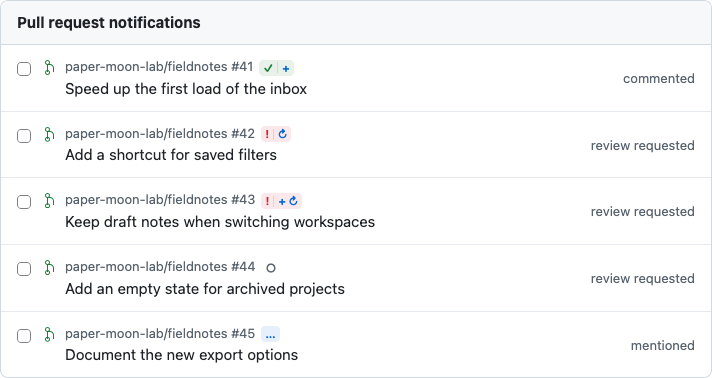

# GitHub Inbox Reviews

Ever reopen a GitHub notification and realize you already reviewed the PR? This little Firefox add-on puts your last review next to the PR number so you can tell at a glance.

**✓** Approved · **!** Changes requested · **…** Commented · **○** No review yet

A **+** means the head commit has changed since your review. Rebases count. A **↻** means GitHub is asking you to review again. Hover over the badge for details.

## Try it

You’ll need Firefox, Python 3, and the GitHub CLI (`gh`) on macOS or Linux. Use the same GitHub account in your browser and in `gh`.

1. Clone this repo and run `python3 host.py --install` from the project folder.
2. In Firefox, open `about:debugging#/runtime/this-firefox`, click **Load Temporary Add-on**, and choose [`extension/manifest.json`](extension/manifest.json).
3. Open or refresh [GitHub Notifications](https://github.com/notifications).

The local helper uses your existing `gh` login to read review history. Firefox unloads temporary add-ons when it restarts, so load the manifest again after a restart.
